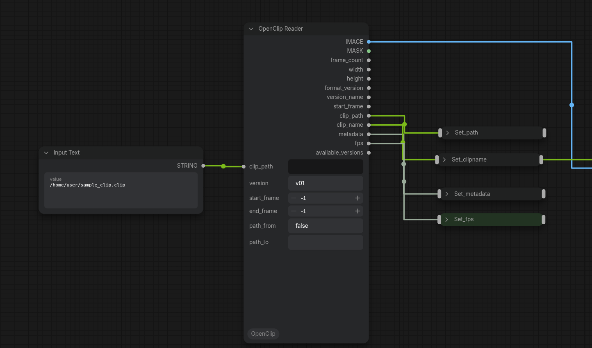
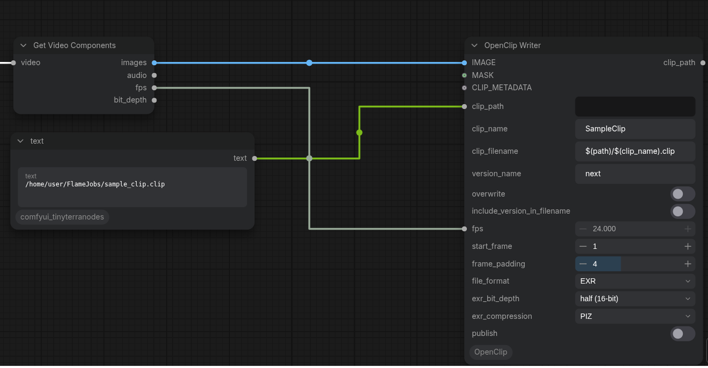
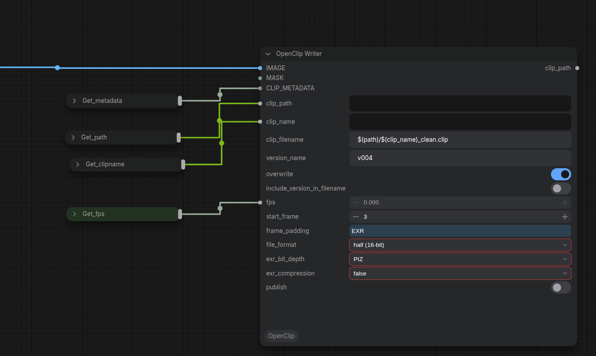
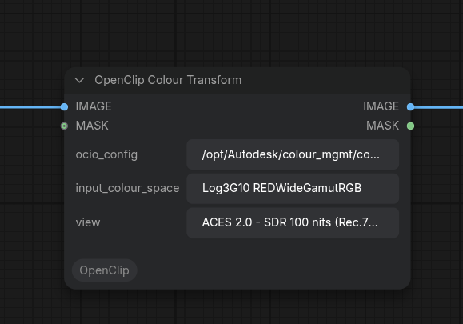

# ComfyOpenClip

OpenClip read/write nodes for ComfyUI, designed for VFX pipelines that use Autodesk Flame, but also other apps that handle OpenClips like Nuke and Baselight.

Frames rendered in ComfyUI are written as versioned OpenClip packages that Flame can import directly from its MediaHub. Clips exported from Flame can be read back into ComfyUI for processing. 

---

## Quick Start

The easiest way to use these nodes is to add an OpenClip Reader node at the beginning of the workflow. Point it at an existing .clip file rendered from Flame, leave version as 'current', and use the IMAGE output. (For a plain `name.####.exr` sequence with no `.clip`, such as a Blender render, use the OpenClip EXR Sequence Reader instead.)

Then at the end of the workflow add a OpenClip Writer node, connecting the finished image into the Image input. Leave the version on the 'next' default, pipe the clip_path, clip_name, metadata, and fps values through from the reader, add "_updated" at the end of the clip_name pattern in the OpenClip Writer and all should be well.

The rest are options for more advanced workflows.

If a specific version should be read, rather than 'current', run the Reader once. The available versions are listed inside the node (and on its `available_versions` output, which you can wire to a Preview Text node). Pick one and copy/paste it into the 'version' input.

## Nodes

### OpenClip Writer
Writes an image sequence and generates a `.clip` XML manifest that Flame can import.

With the default `Standard Flame` layout, the `.clip` file is written into the folder given by the path, next to a folder of the same name that holds the frames:

```
include_version_in_filename off          include_version_in_filename on  (Flame-compatible)
<path>/                                  <path>/
  foo.clip                                 foo.clip
  foo/                                     foo/
    v001/foo.0001.exr …                      foo_v001.0001.exr …
    v002/foo.0001.exr …                      foo_v002.0001.exr …
```

**Turning `include_version_in_filename` on gives the same layout Flame itself uses for its Open Clip exports**, so ComfyUI versions sit alongside Flame's own in the same folder. With it off, each version gets its own subfolder.

Clips written by earlier releases (`foo/foo.clip` with a `versions/` subfolder) can still be read and appended to; new versions added to such a clip keep that older layout.

Various options can be set to configure the clip and the EXR file generation. If the OpenClips are used in a round-trip scenario from Flame, many parameters can be piped through from the read node. (see example 1 in screenshots below).

The write node has the follwing inputs/settings:

- IMAGE: takes an image sequence (if the workflow generates video rather than image batch, use a 'Get Video Components' node to extract an image batch and accompanying parameters).
- MASK (optional): an alpha channel to go with the EXR files.
- CLIP_METADATA (optional): the standard metadata structure. The most common use case is to pipe it through from the Reader to maintain all metadata in the pipeline.
- aov_chain (optional): AOVs to write alongside the beauty pass, built with OpenClip AOV Writer nodes.
- colour_space (optional): the colour space declared in the .clip XML; can be wired from a Reader. Default `Rec.709 video`: the name Flame used before 2026, which Flame 2026 and later still recognise (as an alias of `Rec.1886 Rec.709 - Display`), so the same tag works across Flame versions.
- clip_path: where the OpenClip files will be stored.
- clip_name: logical clip name.
- clip_filename: filename of the .clip file. This uses a pattern, referencing the other clip settings to construct the full filename. Default is: `$(path)/$(clip_name).clip`.
- version_name: the text string of the version. The default of 'next' will allocate the next version, or start with v001.
- overwrite: whether existing versions are allowed to be overwritten. If the latest version is 'v003', and the version_name is also set to 'v003', the existing version 'v003' will be deleted and a new version will be written. If disabled, writing an existing version number results in an error.
- include_version_in_filename: on by default. Adds the version to the frame filenames (`foo_v003.0001.exr`) and puts all versions' frames in one folder — the layout Flame uses for its own Open Clip exports, which lets Flame add its own versions to the clip. Off: one subfolder per version, version not in the filename.
- fps: the frame rate to place into the clip metadata (must match a standard rate such as 23.976, 24, 25, 29.97, 30, 48, 50, 59.94, 60).
- start_frame: the number of the first written frame. Default 1, as Flame numbers its own renders; use 1001 for Nuke or film pipelines. Wire it from the Reader to keep a source clip's numbering.
- frame_padding: how many zeros to put in front of short frame numbers.
- file_format: choose between EXR and PNG (AOVs require EXR).
- exr_bit_depth, exr_compression: EXR specific.
- aov_layout: `Multichannel` writes each AOV as a named part inside the same EXR file; `Separate Files` writes one extra `<name>_AOV_<aov>.####.exr` file per AOV.
- publish: if selected, a copy of the JSON file of the current ComfyUI workflow will be copied next to the version's frames.

The Writer checks the frame rate and the format of an existing clip (size, frame rate, file format) before writing anything, so a refused run leaves nothing on disk.

### OpenClip Reader
Reads any version from an existing `.clip` file and returns an IMAGE and MASK tensor batch. Also owns version browsing/selection — there is no separate selector node.

The reader node has the following inputs/settings:

- clip_path: the full filename of the .clip file to be read.
- version: the version to be read (defaults to 'current', based on which version is marked as current in .clip file)
- end_frame/start_frame: select a specific frame range to be read (-1 means the clip's own range)
- path_from/path_to: replace a path prefix in the media paths stored in the .clip (leave blank to auto-detect, e.g. when a clip made on another machine points at a different mount).
- frame_cap: read at most this many frames (-1 = no cap).

The node as the following outputs:

- IMAGE: the image batch read from the file.
- MASK: the alpha channel read from the file (fully opaque if the source has no alpha).
- frame_count: the number of frames read.
- width/height: the dimensions of the canvas.
- format_version: the OpenClip XML schema version (e.g. 6–9; 9 is Flame 2027.1). Wire into the Writer's `format_version` to write a new clip at the same version.
- version_name: the resolved version that was actually read (e.g. `v002`, never the literal 'current').
- start_frame: first frame number, for wiring into the Writer.
- clip_path: the path of the .clip file that was read.
- clip_name: the name of the clip that was read.
- metadata: the EXR header metadata (CLIP_METADATA).
- aov_handle: a lightweight handle to the clip's frames for the OpenClip AOV Reader (decodes nothing itself).
- colour_space: the colour space recorded in the EXR header.
- fps: frame rate indicated in the file.
- available_versions: a text output (also shown in the node) listing the versions in the file.
- available_aovs: a text output (also shown in the node) listing the AOV/part names found in the first frame.

The Reader also takes an optional frame range and version. Queue the Reader alone to inspect a clip's versions and AOVs.

### OpenClip EXR Sequence Reader
Reads plain `name.####.exr` sequences with no `.clip` file, such as Blender renders (including Blender's single-part "OpenEXR MultiLayer" layout) or Nuke output. Provides the same IMAGE/MASK outputs in the same positions as the OpenClip Reader, so the two can be swapped behind a switch node, plus the `aov_handle` and `available_aovs` outputs.

### OpenClip AOV Reader
Takes an `aov_handle` from either reader and a `part_name`, and decodes only that one named part (e.g. depth, normals, a puzzle matte). Outputs `image` and `matte`; a single-channel AOV is returned as `matte` only. Use `available_aovs` on the reader to see the names. Cryptomatte decoding is not supported. If the named part is not found in any frame, the outputs are `None`.

### OpenClip AOV Writer
Builds an `AOV_WRITE_CHAIN` of named AOV entries (`name`, `image` and/or `matte`). Chain several together via `aov_chain`, then wire the result into the OpenClip Writer's `aov_chain` input. AOVs can only be written to EXR, not PNG.

### OpenClip Colour Space Transform
Converts between OCIO colour spaces; the target can be 'Same as input (via pipe)', using the Reader's `colour_space` output.

### OpenClip Colour Transform

Applies an OCIO display/view transform (including the ACES output transform, with a selectable `view`) to make log and camera spaces compatible with models that have been trained on BT1886/Rec709 footage.

Insert after the reader and before the rest of the workflow.

The config defaults to the `$OCIO` environment variable if set; otherwise, on Flame 2026 or later workstations, to the ACES 2.0 OCIO config that ships with Flame (`/opt/Autodesk/colour_mgmt/configs/flame_configs/<version>/aces2.0_config/config.ocio`).

### Flame 2025 and earlier (SynColor)

Both colour transform nodes use OCIO. Flame switched from its own SynColor colour management to OCIO in Flame 2026, so on older Flame workstations there's no default config to find. You have two options:

- **Do the colour conversion in Flame** before and after ComfyUI, and leave these nodes out of the workflow.
- **Use one of Autodesk's SynColor-emulation OCIO configs.** These ship with Flame 2026 and later in `/opt/Autodesk/colour_mgmt/configs/legacy_configs/` (e.g. `syncolor_aces1.1_config/config.ocio`). They are not part of this node pack; copy the folder from a Flame 2026+ install or obtain it from Autodesk, then point `ocio_config` (or `$OCIO`) at its `config.ocio`. With such a config:
  - Colour space names are the old SynColor names (e.g. `Rec.709 video`, `scene-linear Alexa WideGamut`). The Colour Space Transform's dropdown entries and the Colour Transform's display are translated automatically; anything typed by hand must use the old names. `Sony S-Log3 (S-Gamut3.Cine)` has no equivalent in these configs.
  - The default `view` (`ACES 2.0 - SDR 100 nits (Rec.709)`) doesn't exist; use e.g. `ACES 1.1 SDR-video (Rec.709 limited)` or `ACES 1.0 SDR-video`. A wrong view name produces an error listing the available ones.
  - These configs emulate the old SynColor transforms; an exact match to what a given pre-2026 Flame produced hasn't been verified.

---

## Screenshots

Several screenshots showing latest version of the nodes in action. There are two versions of the write node, one that is paired with the read node, the other that is independent on a brand new open clip file generated by a workflow.






---

## Requirements

| Package | Purpose | Required |
|---|---|---|
| `lxml` | XML parse and serialise | Always |
| `openimageio` | EXR and PNG I/O | Always |
| `opencolorio` | OCIO colour transforms | Colour transform nodes only |

**ComfyUI Manager** installs all dependencies automatically from `requirements.txt` when you install the node pack — no manual steps needed.

**Manual install:**
```bash
pip install -r requirements.txt
```

If you don't need the colour transform nodes, `opencolorio` can be skipped — the other nodes will load and run without it.

---

## Installation

**Via ComfyUI Manager / the ComfyUI Registry** (recommended): search for "OpenClip" in the Manager, or run `comfy node install comfy-openclip`.

**Manual:**
```bash
cd ComfyUI/custom_nodes
git clone https://github.com/allklier/ComfyUI_OpenClip.git
```

Restart ComfyUI. The nodes appear under the **OpenClip** category.

---

## Notes

- New clips are written as OpenClip schema version 6 by default, so that older Flame releases can import them; set the Writer's `format_version` (5–9) to change it. Adding a version to an existing clip keeps that clip's own schema version and all of Flame's metadata.
- Tested with Flame 2027: a clip written by the Writer opens, and Flame can add its own versions to it. Flame 2024 and 2025 have not been tested; schema 6 and the `Rec.709 video` tag were chosen for them, based on a Flame 2024.1 user's report and the names older Flame wrote.
- Pattern-based clips (`ScanPattern`) and clips referencing movie files (`.mov` etc.) can't be read; stereo clips read the left eye.
- Screenshots below predate the AOV and EXR Sequence Reader nodes.
- Frames are never clamped on the EXR path (half or float); PNG output is 8-bit and does clamp.
- The Colour Transform node's `view` input defaults to `ACES 2.0 - SDR 100 nits (Rec.709)` to match what Flame expects on import, but any view exposed by the OCIO config can be used instead.
- Flame users can point the OCIO config field at their project config, typically found at `/opt/Autodesk/colour_mgmt/configs/flame_configs/<version>/aces2.0_config/config.ocio`.
